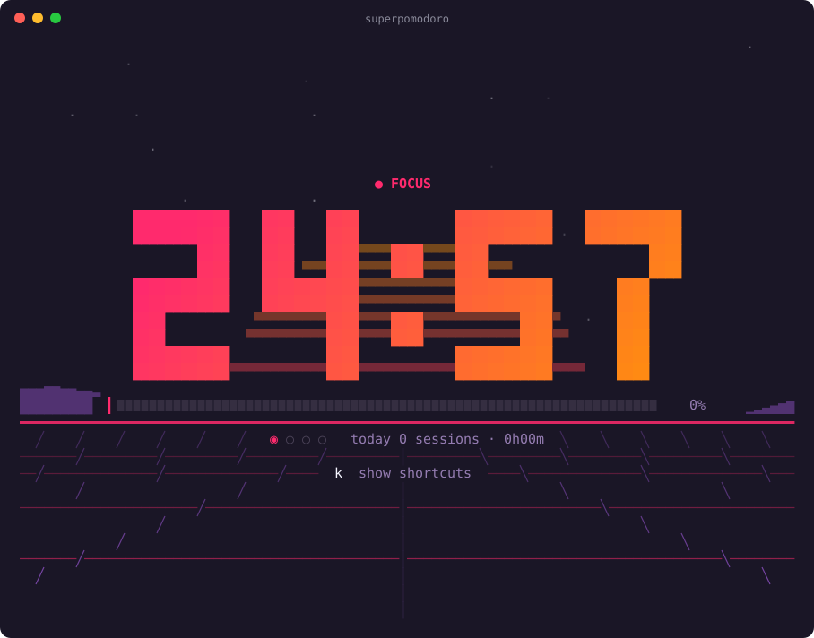
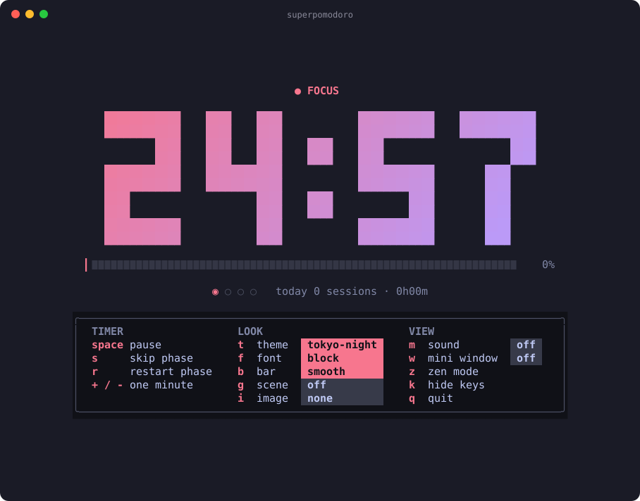
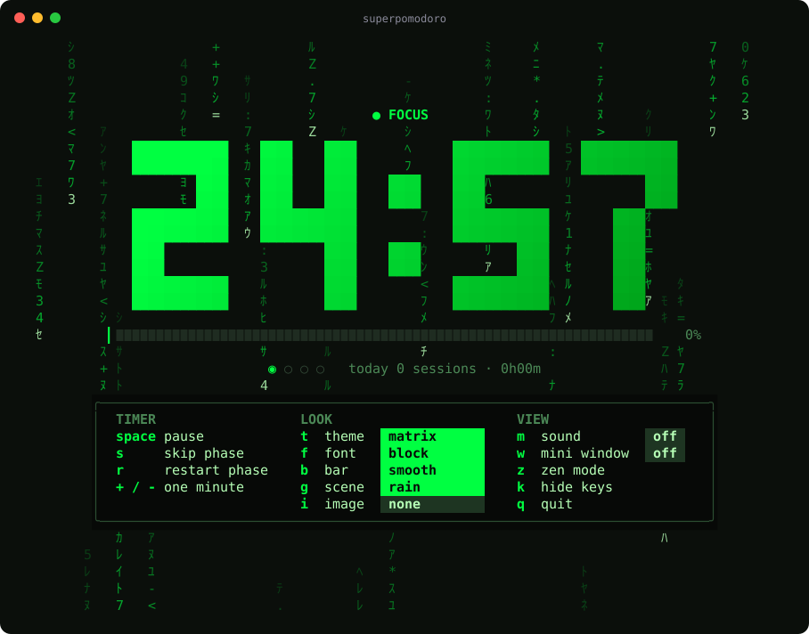
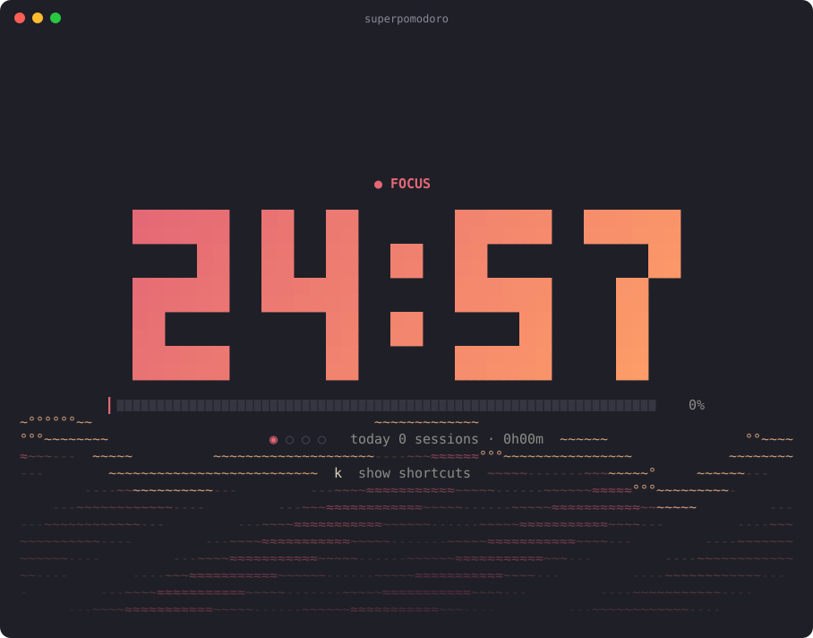
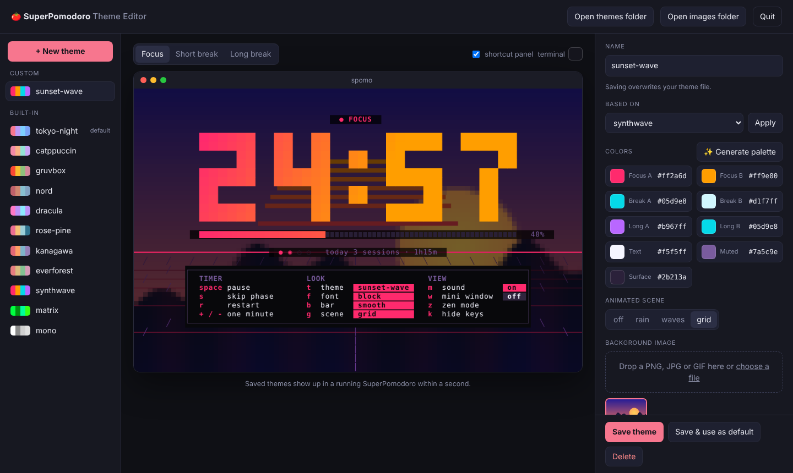
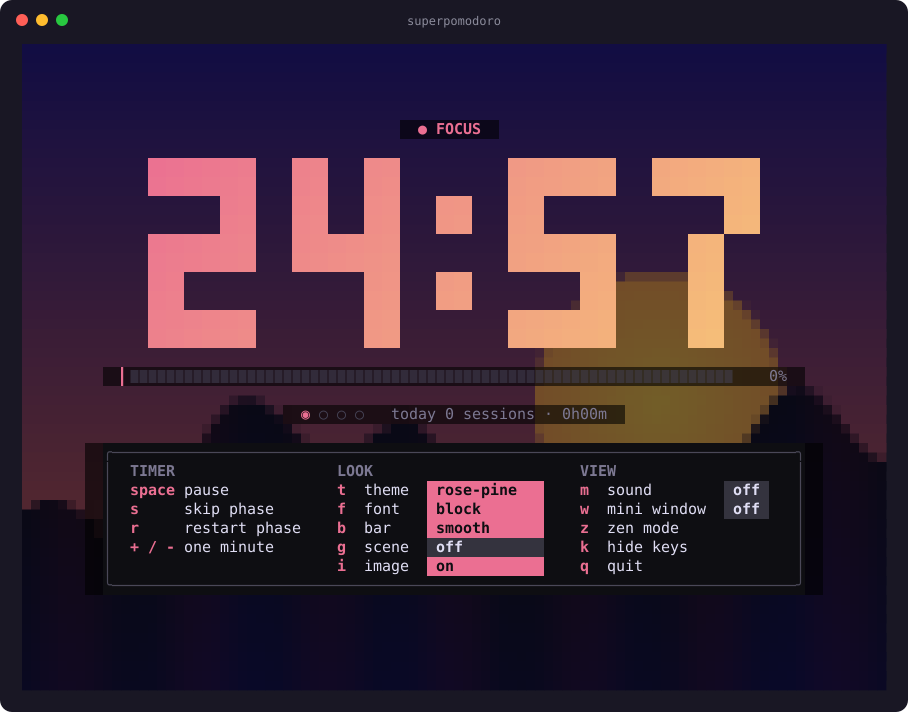

<div align="center">

# 🍅 SuperPomodoro

**A beautiful Pomodoro timer for your terminal, with a floating mini window on macOS.**

[](https://github.com/paymansuper/terminal-superpomodoro/actions/workflows/ci.yml)
[](https://github.com/paymansuper/terminal-superpomodoro/releases)
[](go.mod)
[](LICENSE)



</div>

SuperPomodoro turns your terminal into a calm, good looking focus timer. Big gradient digits, eleven hand tuned color themes and a few carefully designed animated scenes. When you want your screen back, press `w` and the timer shrinks into a small window in the corner that stays on top of everything. When a phase ends, it comes back to the center of the screen so you can't miss it.

It is a single Go binary with zero dependencies, plus a tiny native Swift helper for the macOS mini window.

## Features

- **Big, readable clock** with gradient digits, six digit fonts and five progress bar styles
- **Eleven themes**, from Tokyo Night and Catppuccin to Gruvbox, Nord and a monochrome option
- **Three animated scenes** that mean something, like a retro sun that sets as the phase runs out
- **Theme editor in your browser** with color pickers, palette generator, image drag and drop and a live preview
- **Share themes** as a single `.spomotheme` file with colors and image included, import in the terminal or the browser
- **Your own themes** as tiny text files that extend a built-in theme and reload live while you edit
- **Image backgrounds** from any PNG, JPG or GIF, drawn right in the terminal
- **Floating mini window on macOS** that stays above all windows, desktops and full screen apps
- **Sounds and notifications** at the end of every phase, with any system sound or your own file
- **Readable on any background**, text colors adapt to your terminal's real background color
- **Daily stats** with completed sessions and focused time
- **Keyboard driven**, every action is one key and an on screen legend shows them all
- **Remembers your setup**, theme, font and preferences persist between runs

## Installation

### Homebrew (macOS and Linux)

```sh
brew install paymansuper/tap/superpomodoro
```

This installs `superpomodoro`, the short alias `spomo` and on macOS the mini window helper.

### From source

Requires Go 1.22 or newer, and on macOS the Xcode Command Line Tools for the mini window.

```sh
git clone https://github.com/paymansuper/terminal-superpomodoro.git
cd superpomodoro
make install
```

`go install github.com/paymansuper/terminal-superpomodoro/cmd/superpomodoro@latest` works as well, but only installs the terminal app without the mini window.

### Prebuilt binaries

Every [release](https://github.com/paymansuper/terminal-superpomodoro/releases) ships binaries for macOS and Linux on amd64 and arm64. They contain the terminal app only, use Homebrew or `make` to get the mini window as well.

## Quick start

```sh
spomo                                   # 25 min focus, 5 min short break, 15 min long break, 4 rounds
spomo --work 50 --short 10              # longer sessions
spomo --theme matrix                    # pick a theme
spomo --zen --auto                      # just clock and bar, phases start automatically
```

Press `space` to start. Everything else is one key away.

## Keyboard shortcuts

| Key | Action |
| --- | --- |
| `space` | Start or pause the timer |
| `s` | Skip to the next phase |
| `r` | Restart the current phase |
| `+` `-` | Add or remove one minute |
| `t` `T` | Next or previous theme |
| `f` | Change the digit font |
| `b` | Change the progress bar |
| `g` | Cycle the background animation |
| `i` | Background image on or off |
| `z` | Zen mode, clock and bar only |
| `m` | Sound on or off |
| `w` | Mini window in the top right corner (macOS) |
| `k` | Show or hide the shortcut legend |
| `q` | Quit |

The shortcut panel groups everything into timer, look and view, and shows the current value of every setting as a colored chip, so you always see what is active.

## Themes

| | |
| :---: | :---: |
| <br>**tokyo-night** | <br>**matrix** |
| <br>**synthwave** | <br>**kanagawa** |

All themes: `tokyo-night`, `catppuccin`, `gruvbox`, `nord`, `dracula`, `rose-pine`, `kanagawa`, `everforest`, `synthwave`, `matrix`, `mono`.

Each phase has its own color pair, so you can tell focus, short break and long break apart at a glance.

### Animated scenes

Three themes come with a scene of their own, all others are styled by color only.

| Scene | Default for | What you see |
| --- | --- | --- |
| `grid` | synthwave | A striped retro sun behind the digits that sets as the phase runs out, a mountain ridge and a perspective floor moving toward you |
| `rain` | matrix | Falling katakana code rain |
| `waves` | kanagawa | A rolling sea at the bottom of the screen |

Press `g` to put any scene on any theme or to turn it off. Text always keeps a calm strip behind it so it stays readable.

### Fonts and bars

Digit fonts `block`, `shade`, `pixel`, `dots`, `ghost`, `ascii`, switched with `f`.
Progress bars `smooth`, `line`, `dots`, `blocks`, `wave`, switched with `b`.

## Theme editor

```sh
spomo themegen
```

<div align="center"></div>

Opens a theme editor in your browser with a live preview of the timer.

- Pick every color with a color picker or let **✨ Generate palette** suggest a harmonious one
- Switch the preview between focus, short break and long break, and simulate your terminal's background color
- Choose the animated scene, drop in a background image and tune its brightness
- **Open themes folder** and **Open images folder** show the files in Finder or your file manager
- **Save & use as default** makes it your startup theme right away
- **Export** downloads the current theme, **Export all** every custom theme, **Import** (or dropping a file anywhere) brings themes in

Saved themes appear in a running SuperPomodoro within a second, so you can keep the timer open next to the editor. The editor runs only on `127.0.0.1`, is protected by a one time token in its link and stops with `Ctrl+C` or the Quit button.

## Custom themes

Prefer a text editor? Create your own theme in one command. It starts as a copy of any existing theme, so you only change what you care about.

```sh
spomo theme new fjord --from nord       # writes ~/.config/superpomodoro/themes/fjord.theme
spomo --theme fjord
```

A theme file is plain text and every line is optional.

```ini
extends = "nord"                    # start from any built-in or custom theme

focus   = "#5e81ac #88c0d0"         # gradient for digits and bar during focus
break   = "#a3be8c #ebcb8b"         # during a short break
long    = "#b48ead #88c0d0"         # during a long break

text    = "#eceff4"                 # interface text
muted   = "#4c566a"                 # secondary text
surface = "#3b4252"                 # subtle decoration

scene   = "waves"                   # rain, waves, grid or off
image   = "~/Pictures/fjord.jpg"    # optional background image
image_brightness = 0.4
```

Save the file while the timer is running and the change shows up within a second, so you can tune colors live. A file named after a built-in theme, for example `matrix.theme`, modifies that theme. `spomo theme list` shows all themes and `spomo theme dir` prints the folder. There is an example in [`examples/fjord.theme`](examples/fjord.theme).

## Sharing themes

Themes travel as `.spomotheme` files. One file holds one theme or a whole collection, with every color resolved and the background image embedded, so it works on any machine as is.

```sh
spomo theme export fjord                   # writes fjord.spomotheme
spomo theme export --all -o my.spomotheme  # all your custom themes in one file
spomo theme import ~/Downloads/fjord.spomotheme
```

In the theme editor the same works with the **Export**, **Export all** and **Import** buttons, or by dropping a file onto the page. Imported themes open right away, ready to be tweaked.

If a name is already taken the import adds a suffix like `fjord-2` instead of overwriting, `--force` overwrites on purpose. Plain `.theme` files can be imported too. The format is documented in [docs/theme-format.md](docs/theme-format.md) with a [JSON Schema](docs/theme-format.schema.json), and [`examples/fjord.spomotheme`](examples/fjord.spomotheme) is a ready to import example.

## Background images

<div align="center"></div>

Any PNG, JPG or GIF can sit behind the timer. SuperPomodoro scales it to fill the window and darkens it so the clock stays readable.

- **Sharp, in full resolution** in Ghostty and Kitty (Kitty graphics protocol, the picture sits below the text) and in iTerm2 (as the session background image, removed again when you quit)
- **Pixel style** everywhere else, drawn with half block characters, two pixels per cell, in any true color terminal. Text gets a calm, darker strip behind it.

The right mode is picked automatically. Set `image_mode = "pixel"` if you like the retro look everywhere, or `"sharp"` to force the Kitty protocol in a terminal that isn't detected.

```sh
spomo --image ~/Pictures/sunset.jpg     # just for this run
```

Set it permanently with `image` and `image_brightness` in the config, or per theme in a theme file. A theme's own image wins over the global one, and `--image` wins over both. Press `i` to switch it on and off. The mini window on macOS shows the same picture.

In pixel style, the larger your terminal window and the smaller the font, the more detail you get. Inside tmux or screen the pixel style is used, because they don't pass pictures through.

## Mini window (macOS)

Press `w` and the terminal minimizes itself while a small window keeps the timer running in the top right corner. It floats above every other window, on all desktops and over full screen apps. Drag it anywhere and it remembers the spot.

**When a phase ends** the window moves to the center of the screen, grows and stays above everything until you react.

| Key or action | In the centered window |
| --- | --- |
| `space` or `return` | Start the next phase and return to the corner |
| `esc` | Later, back to the corner without starting |
| Open terminal | Bring the terminal back |

**Back to the terminal** by clicking the small window and pressing `w` again, or by double clicking it. Once clicked it also understands `space` and `s`, just like the terminal.

**Hiding it** works with the button that appears on hover. A hidden window still comes back at the end of the phase, and `⌃⌥P` shows or hides it from anywhere.

The window is a native Swift app called `superpomodoro-float` and needs macOS 12 or newer. The terminal stays the single source of truth, the window only mirrors it and closes itself when you quit the timer.

## Configuration

Themes have their own files, see [Custom themes](#custom-themes). Settings live in `~/.config/superpomodoro/config` (or `$XDG_CONFIG_HOME/superpomodoro/config`) as plain `key = value` lines. Theme, font, bar, background, legend and sound choices are saved automatically when you quit. Command line flags only apply to the current run.

```ini
work = 50
short = 10
long = 20
rounds = 4
theme = "catppuccin"
font = "block"
bar = "smooth"
bg = "auto"
auto = false
sound = true
sound_focus = "Glass"
sound_break = "/Users/me/sounds/gong.aiff"
notify = true
bell = false
keys = true
raise = true
zen = false
term_bg = "#1e1e2e"
image = "~/Pictures/sunset.jpg"
image_brightness = 0.45
image_mode = "auto"
```

| Key | Default | Description |
| --- | --- | --- |
| `work` `short` `long` | `25` `5` `15` | Phase lengths in minutes |
| `rounds` | `4` | Focus rounds before a long break |
| `theme` `font` `bar` | `tokyo-night` `block` `smooth` | Look of the timer |
| `bg` | `auto` | Background scene, `auto` follows the theme, or `off`, `rain`, `waves`, `grid` |
| `auto` | `false` | Start the next phase automatically |
| `sound` | `true` | Play a sound when a phase ends |
| `sound_focus` `sound_break` | `Glass` `Hero` | Sound after focus and after a break, a name from `/System/Library/Sounds` or a file path |
| `notify` | `true` | Desktop notification at the end of a phase |
| `bell` | `false` | Ring the terminal bell as well |
| `keys` | `true` | Show the shortcut legend |
| `raise` | `true` | Bring the terminal to the front when a phase ends (without the mini window) |
| `zen` | `false` | Start in zen mode |
| `term_bg` | | Your terminal background color, only needed if the terminal doesn't report it |
| `image` | | Background image for all themes (png, jpg or gif) |
| `image_brightness` | `0.45` | How bright the image is drawn, from 0 to 1 |
| `image_mode` | `auto` | `auto` picks sharp or pixel by terminal, `sharp` or `pixel` forces one |

### Command line flags

```
--work <min>     --short <min>    --long <min>    --rounds <n>
--theme <name>   --font <name>    --bar <name>    --bg <name>
--image <file>   --auto           --zen           --bell
--no-sound       --no-notify      --version

spomo themegen                         theme editor in the browser
spomo theme list | new <name> [--from <theme>] | dir
spomo theme export <name>... | --all [-o file]
spomo theme import <file> [--force]
```

Run `spomo --help` for the full list with all theme, font, bar and scene names.

## Terminal support

SuperPomodoro uses 24 bit color and works best in a terminal that supports it, which is almost every modern one.

| Terminal | Timer | Sharp background images | Auto minimize for the mini window |
| --- | :---: | :---: | :---: |
| Ghostty | ✓ | ✓ | minimize by hand |
| Kitty | ✓ | ✓ | depends on settings |
| iTerm2 | ✓ | ✓ | ✓ |
| Terminal.app | ✓ | pixel style | ✓ |
| WezTerm | ✓ | pixel style | depends on settings |
| Alacritty, Warp | ✓ | pixel style | minimize by hand |

On start the app asks the terminal for its background color and lifts any text color that would be hard to read on it, while keeping the theme's hue. If your terminal doesn't answer, set `term_bg` in the config.

## How it works

```
┌──────────────────────┐   state.json (5x per second)   ┌───────────────────────┐
│  superpomodoro (Go)  │ ─────────────────────────────▶ │  superpomodoro-float  │
│  timer, terminal UI  │ ◀───────────────────────────── │  native Swift window  │
└──────────────────────┘   cmd (start, skip, restore)   └───────────────────────┘
```

The terminal app is written in plain Go without any third party modules. It draws every frame onto an in memory canvas, layers the background scene below the interface and only sends color changes to the terminal. The mini window is a single Swift file using AppKit and SwiftUI. Both talk through two small files in your user cache directory, so there is no network, no daemon and nothing left running after you quit.

```
cmd/superpomodoro/   terminal app (timer, rendering, themes, scenes, images, config)
macos/main.swift     floating mini window for macOS
Formula/             Homebrew formula template
examples/            example theme, as .theme and .spomotheme
docs/                screenshots
```

## Contributing

Issues and pull requests are welcome. See [CONTRIBUTING.md](CONTRIBUTING.md) for how to build, test and add a theme.

## License

[MIT](LICENSE) © Payman Supervizer
